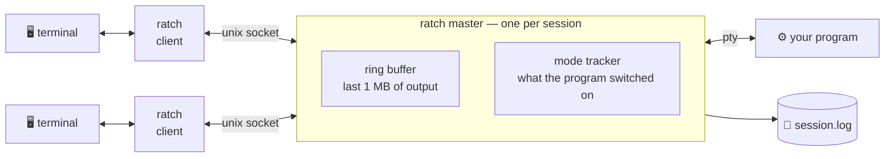

<h1 align="center">ratch</h1>

<p align="center">
  <b>Leave a terminal program running. Come back to it later, from anywhere.</b>
</p>

<p align="center">
  <a href="https://github.com/s85io/ratch/actions/workflows/ci.yml"></a>
  
  
</p>

<p align="center"><b>English</b> · <a href="README.ru.md">Русский</a></p>

```console
$ ratch work                 # attach to "work"; created if it does not exist
$ make -j8                   # start something long, then press Ctrl-\
[ratch: session 'work' detached after 12s]

$ ratch list
work                     since 3m 2s ago  pid 4242  /bin/zsh

$ ratch work                 # later, from another machine: right where you left it
```

## ✨ What it does

- 🔌 **Detach and reattach** — the program keeps running without a terminal.
- 🪟 **No terminal emulation** — bytes pass through unchanged, so mouse, true colour, images and `$TERM` work as they do without it.
- 📜 **History** — recent output is replayed on attach; all of it is in a log.
- 🖥️ **Terminal state** — attaching switches on the modes the program uses (alternate screen, mouse, bracketed paste, keyboard protocol); detaching switches them off.
- 🚦 **Nothing waits** — a hung or slow terminal never stalls the program or other terminals.
- 📦 **One static binary**, no configuration file.

It is not a multiplexer: no windows, panes or status line. For those, use tmux.

## 🧭 How it works



Each session has a **master** process that owns the program's pseudo-terminal.
Output goes into a ring buffer; every attached client is a cursor into it and
reads at its own pace. A client that falls more than the buffer behind skips
ahead instead of holding anyone up. The master also remembers which terminal
modes the program switched on, so a terminal that attaches later can be put
into them.

## 💡 Inspired by atch

`ratch` is a rewrite in Rust of [atch](https://github.com/mobydeck/atch),
which builds on [dtach](https://github.com/crigler/dtach) by Ned T. Crigler.

dtach showed that detaching does not need a terminal emulator. atch made that
pleasant: named sessions, `atch work` to attach or create, a log that gives a
session a past, one small binary. `ratch` keeps all of that and replaces the
core, to fix what gave way in daily use:

| | atch | ratch |
|---|---|---|
| 🚦 A terminal that stops reading | stops the program | falls behind on its own |
| 🖥️ Attaching to a full-screen program | modes are lost | terminal is put into the program's modes |
| ↩️ Detaching from one | modes stay on in your shell | switched off again |
| 📜 History on attach | the whole log, replayed by the client | the recent part, with terminal queries taken out |
| 🏁 Two creators of one session at once | not guarded against | one wins, the other is told |
| 🔢 How a session ended | not recorded | `ratch wait` returns its exit status |

It is not a drop-in replacement: the two cannot attach to each other's
sessions, and the dtach-style flags are gone. See the [changelog](CHANGELOG.md).

## 📦 Install

Download a binary from the [releases page](https://github.com/s85io/ratch/releases), or build it:

```sh
cargo build --release      # target/release/ratch
make install               # /usr/local: binary, man page, completions
```

Packaging for Arch, Debian, Gentoo and Homebrew is in [`pkg/`](pkg).

## 🚀 Usage

```
ratch [options] <session> [command...]   attach to a session, creating it if needed
ratch [options] <command> ...
```

Without a command, a session runs your `$SHELL`. A session name containing
`/` is taken as the path of the session's socket.

### Commands

| Command | |
|---|---|
| `attach <session>` | Attach; fail if the session is not running |
| `new <session> [command...]` | Create a session and attach |
| `start <session> [command...]` | Create a session without attaching |
| `run <session> [command...]` | Create a session, staying in the foreground as its master |
| `push <session>` | Send stdin to the session as if typed |
| `kill [-f] <session>` | Stop a session: SIGTERM, then SIGKILL after 5 s; `-f` at once |
| `wait [-t secs] <session>` | Wait for a session to end; exit with the program's status |
| `log [-f] [-n N] <session>` | Print the session's output; `-n` last N lines, `-f` follow |
| `tail [-f] [-n N] <session>` | The same, last 10 lines by default |
| `clear [<session>]` | Forget the session's history |
| `list [-a] [--names]` | List sessions; `-a` includes finished ones |
| `rm <session>` · `rm -a` | Remove what a finished or dead session left behind |
| `rename <session> <new-name>` | Rename a running session |
| `env [--sh\|--fish] [<session>]` | Print commands that refresh a shell's environment |
| `current` | Print the session this shell is running in |

`wait` exits with the program's exit code, `128 + N` for signal N, `124` when
`-t` runs out, `255` when the session ended without saying how.

### Options

Before the command, or after the session name.

| Option | |
|---|---|
| `-e <char>` | Detach character, as a character or `^X` (default `^\`) |
| `-E` | No detach character |
| `-n <lines>` | History to show on attach (default: last 128 kB; `0`: none) |
| `--ro` | Attach read-only |
| `-R none\|clear` | `clear` wipes the screen and scrollback before attaching |
| `-r none\|ctrl_l\|winch` | How to ask the program to redraw (default `winch`) |
| `-H` | Keep the session open with a shell after the command ends |
| `-C <size>` | Log size limit such as `128k`, `4m`; `0` keeps no log (default `1m`) |
| `-z` | Do not interpret the suspend key |
| `-q` | Suppress messages |
| `-t` | Send the terminal no escape sequences |

Defaults can go in the environment: `export RATCH_OPTS="-e ^A -R clear"`.

## 🧪 Examples

```sh
ratch start build make -j8                 # a build you can walk away from
ratch log -f build                         # watch it
ratch wait build && echo "build done"      # act on how it ends

ratch start -H api ./server --port 8080    # keep the session after the server exits
ratch attach --ro api                      # look without the risk of typing

echo "git pull" | ratch push work          # type into a session from a script

ratch list -a && ratch rm -a               # tidy up
```

After attaching from a different terminal, a long-lived shell still has the
old terminal's environment (`SSH_AUTH_SOCK`, `DISPLAY`, `TERM`, …):

```sh
eval "$(ratch env)"           # bash, zsh
ratch env --fish | source     # fish
```

## 📁 Files and environment

Sessions live in `~/.cache/ratch` (or `$RATCH_SESSION_DIR`), which must be
yours and mode 0700.

| | |
|---|---|
| `<session>` | the session's socket |
| `<session>.log` | its output |
| `<session>.info` | process ids, command, how it ended |
| `<session>.env` | environment of the terminal that attached last |

| Variable | |
|---|---|
| `RATCH_OPTS` | options applied before the command line's |
| `RATCH_SESSION_DIR` | where to keep sessions |
| `RATCH_ENV_VARS` | more variable names for `env` to carry |
| `RATCH_SESSION` | set inside a session: its socket path (a `:`-separated chain when nested) |

A copy of the binary under another name keeps to itself: `foo` uses
`~/.cache/foo` and `FOO_*`.

## ⚠️ Good to know

- 🔐 Any process running as you can attach to, type into and stop your sessions; nobody else can.
- 🖼️ There is no picture of the screen: after attaching, a full-screen program repaints itself. One that ignores window changes stays blank until it draws again; try `-r ctrl_l`.
- 📐 Terminals attached to one session share one window size: the last to attach or resize sets it.
- 🔁 A session cannot be attached, or killed without `-f`, from inside itself.
- 🐡 Linux and macOS are supported. On FreeBSD it builds and mostly works, but the output of a program that exits immediately after writing can be lost.
- 🧹 With systemd's `KillUserProcesses=yes`, sessions die at logout; `loginctl enable-linger` keeps them.

## 🛠 Building and testing

```sh
make            # cargo build --release
make check      # format, lint, unit, integration and black-box tests
```

Layers, each using only those below: `cli` → `client`, `master` → `session`
→ `proto`, `ring`, `vt` (pure logic) → `sys` (the only place with `unsafe`).

## 📜 License

GPL-2.0-or-later, the licence of dtach, from which atch and through it
`ratch` descend. The history of this repository starts with atch's.
