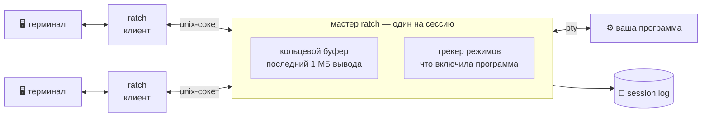

<h1 align="center">ratch</h1>

<p align="center">
  <b>Оставьте программу работать в терминале. Вернитесь к ней позже — откуда угодно.</b>
</p>

<p align="center">
  <a href="https://github.com/s85io/ratch/actions/workflows/ci.yml"></a>
  
  
</p>

<p align="center"><a href="README.md">English</a> · <b>Русский</b></p>

```console
$ ratch work                 # подключиться к «work»; если её нет — создать
$ make -j8                   # запустить что-то долгое и нажать Ctrl-\
[ratch: session 'work' detached after 12s]

$ ratch list
work                     since 3m 2s ago  pid 4242  /bin/zsh

$ ratch work                 # позже, с другой машины: всё на том же месте
```

## ✨ Что умеет

- 🔌 **Отключение и подключение** — программа продолжает работать без терминала.
- 🪟 **Без эмуляции терминала** — байты проходят как есть, поэтому мышь, true colour, картинки и `$TERM` работают так же, как без ratch.
- 📜 **История** — при подключении показывается недавний вывод; весь вывод лежит в логе.
- 🖥️ **Состояние терминала** — при подключении включаются режимы, которыми пользуется программа (альтернативный экран, мышь, bracketed paste, протокол клавиатуры); при отключении они выключаются.
- 🚦 **Никто никого не ждёт** — зависший или медленный терминал не тормозит ни программу, ни другие терминалы.
- 📦 **Один статический бинарник**, без конфигурационного файла.

Это не мультиплексор: окон, панелей и строки состояния нет. Для них есть tmux.

## 🧭 Как это устроено



У каждой сессии есть процесс-**мастер**, который владеет псевдотерминалом
программы. Вывод складывается в кольцевой буфер; каждый подключённый клиент —
это курсор в нём, и читает он в своём темпе. Клиент, отставший больше чем на
размер буфера, перескакивает вперёд и никого не задерживает. Мастер также
помнит, какие режимы терминала включила программа, чтобы привести в них
терминал, подключившийся позже.

## 💡 Вдохновлён atch

`ratch` — это [atch](https://github.com/mobydeck/atch), переписанный на Rust;
atch, в свою очередь, основан на [dtach](https://github.com/crigler/dtach)
Неда Криглера.

dtach показал, что для отключения не нужен эмулятор терминала. atch сделал
это удобным: имена сессий, `atch work` — «подключись или создай», лог,
который даёт сессии прошлое, один маленький бинарник. `ratch` сохраняет всё
это и заменяет ядро, чтобы исправить то, что подводило в ежедневной работе:

| | atch | ratch |
|---|---|---|
| 🚦 Терминал перестал читать | программа останавливается | терминал отстаёт сам по себе |
| 🖥️ Подключение к полноэкранной программе | режимы теряются | терминал приводится в режимы программы |
| ↩️ Отключение от неё | режимы остаются включёнными в вашем шелле | выключаются |
| 📜 История при подключении | весь лог, его проигрывает клиент | недавняя часть, без запросов к терминалу |
| 🏁 Двое создают одну сессию одновременно | защиты нет | один выигрывает, второму сообщают |
| 🔢 Чем закончилась сессия | не записывается | `ratch wait` возвращает код завершения |

Это не замена один-в-один: подключаться к сессиям друг друга они не умеют,
а флагов в стиле dtach больше нет. Подробности — в [списке изменений](CHANGELOG.md).

## 📦 Установка

Скачайте бинарник со [страницы релизов](https://github.com/s85io/ratch/releases) или соберите:

```sh
cargo build --release      # target/release/ratch
make install               # в /usr/local: бинарник, man-страница, автодополнение
```

Файлы для сборки пакетов Arch, Debian, Gentoo и Homebrew лежат в [`pkg/`](pkg).

## 🚀 Использование

```
ratch [опции] <сессия> [команда...]   подключиться к сессии, создав её при необходимости
ratch [опции] <команда> ...
```

Без команды в сессии запускается ваш `$SHELL`. Имя сессии, содержащее `/`,
считается путём к её сокету.

### Команды

| Команда | |
|---|---|
| `attach <сессия>` | Подключиться; ошибка, если сессия не запущена |
| `new <сессия> [команда...]` | Создать сессию и подключиться |
| `start <сессия> [команда...]` | Создать сессию, не подключаясь |
| `run <сессия> [команда...]` | Создать сессию и остаться на переднем плане её мастером |
| `push <сессия>` | Передать stdin в сессию, как будто его набрали |
| `kill [-f] <сессия>` | Остановить: SIGTERM, через 5 с SIGKILL; `-f` — сразу |
| `wait [-t сек] <сессия>` | Дождаться конца сессии; выйти с кодом программы |
| `log [-f] [-n N] <сессия>` | Напечатать вывод сессии; `-n` — последние N строк, `-f` — следить |
| `tail [-f] [-n N] <сессия>` | То же, по умолчанию последние 10 строк |
| `clear [<сессия>]` | Забыть историю сессии |
| `list [-a] [--names]` | Список сессий; `-a` — вместе с завершёнными |
| `rm <сессия>` · `rm -a` | Удалить то, что осталось от завершённой или мёртвой сессии |
| `rename <сессия> <новое-имя>` | Переименовать работающую сессию |
| `env [--sh\|--fish] [<сессия>]` | Напечатать команды, обновляющие окружение шелла |
| `current` | Напечатать сессию, внутри которой запущен этот шелл |

`wait` выходит с кодом программы; `128 + N`, если её убил сигнал N; `124`,
если истекло время `-t`; `255`, если сессия закончилась, не сообщив как.

### Опции

Перед командой или после имени сессии.

| Опция | |
|---|---|
| `-e <символ>` | Символ отключения: сам символ или `^X` (по умолчанию `^\`) |
| `-E` | Без символа отключения |
| `-n <строк>` | Сколько истории показать при подключении (по умолчанию последние 128 КБ; `0` — ничего) |
| `--ro` | Подключиться только для просмотра |
| `-R none\|clear` | `clear` очищает экран и прокрутку перед подключением |
| `-r none\|ctrl_l\|winch` | Как просить программу перерисоваться (по умолчанию `winch`) |
| `-H` | Оставить сессию открытой с шеллом после завершения команды |
| `-C <размер>` | Предел размера лога, например `128k`, `4m`; `0` — без лога (по умолчанию `1m`) |
| `-z` | Не обрабатывать клавишу приостановки |
| `-q` | Без сообщений |
| `-t` | Не посылать терминалу escape-последовательности |

Умолчания можно задать в окружении: `export RATCH_OPTS="-e ^A -R clear"`.

## 🧪 Примеры

```sh
ratch start build make -j8                 # сборка, от которой можно уйти
ratch log -f build                         # следить за ней
ratch wait build && echo "сборка готова"   # действовать по результату

ratch start -H api ./server --port 8080    # сессия останется после выхода сервера
ratch attach --ro api                      # посмотреть, ничего случайно не набрав

echo "git pull" | ratch push work          # набрать в сессии из скрипта

ratch list -a && ratch rm -a               # прибраться
```

После подключения с другого терминала у долго живущего шелла остаётся
окружение старого терминала (`SSH_AUTH_SOCK`, `DISPLAY`, `TERM`, …):

```sh
eval "$(ratch env)"           # bash, zsh
ratch env --fish | source     # fish
```

## 📁 Файлы и окружение

Сессии лежат в `~/.cache/ratch` (или в `$RATCH_SESSION_DIR`); каталог должен
принадлежать вам и иметь права 0700.

| | |
|---|---|
| `<сессия>` | сокет сессии |
| `<сессия>.log` | её вывод |
| `<сессия>.info` | идентификаторы процессов, команда, чем закончилась |
| `<сессия>.env` | окружение терминала, подключившегося последним |

| Переменная | |
|---|---|
| `RATCH_OPTS` | опции, применяемые до опций командной строки |
| `RATCH_SESSION_DIR` | где хранить сессии |
| `RATCH_ENV_VARS` | дополнительные имена переменных для `env` |
| `RATCH_SESSION` | задана внутри сессии: путь к её сокету (для вложенных — цепочка через `:`) |

Копия бинарника под другим именем живёт отдельно: `foo` использует
`~/.cache/foo` и `FOO_*`.

## ⚠️ Полезно знать

- 🔐 Любой процесс, запущенный от вашего имени, может подключаться к вашим сессиям, печатать в них и останавливать их; остальные — нет.
- 🖼️ Картинки экрана нет: после подключения полноэкранная программа перерисовывается сама. Если она не реагирует на изменение окна, экран останется пустым до следующей отрисовки; попробуйте `-r ctrl_l`.
- 📐 У терминалов, подключённых к одной сессии, общий размер окна: его задаёт тот, кто подключился или изменил размер последним.
- 🔁 Изнутри сессии нельзя подключиться к ней самой, а остановить её можно только с `-f`.
- 🧹 При `KillUserProcesses=yes` в systemd сессии умирают при выходе из системы; `loginctl enable-linger` их сохраняет.

## 🛠 Сборка и тесты

```sh
make            # cargo build --release
make check      # форматирование, линтер, модульные, интеграционные и black-box тесты
```

Слои, каждый использует только нижние: `cli` → `client`, `master` → `session`
→ `proto`, `ring`, `vt` (чистая логика) → `sys` (единственное место с `unsafe`).

## 📜 Лицензия

GPL-2.0-or-later — лицензия dtach, от которого происходят atch и, через него,
`ratch`. История этого репозитория начинается с истории atch.
